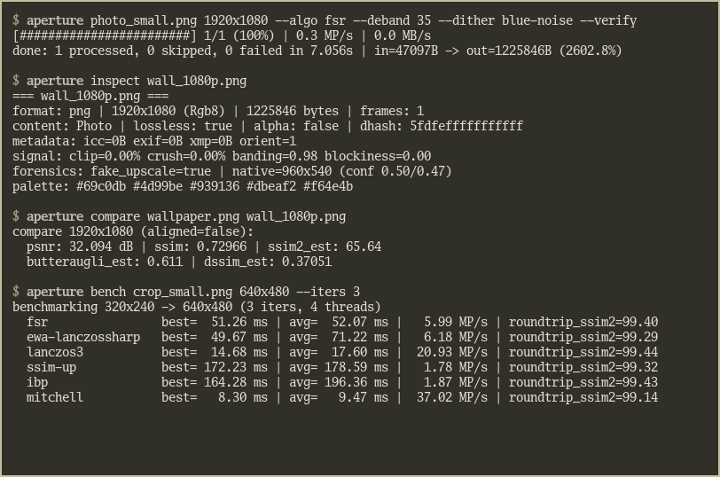
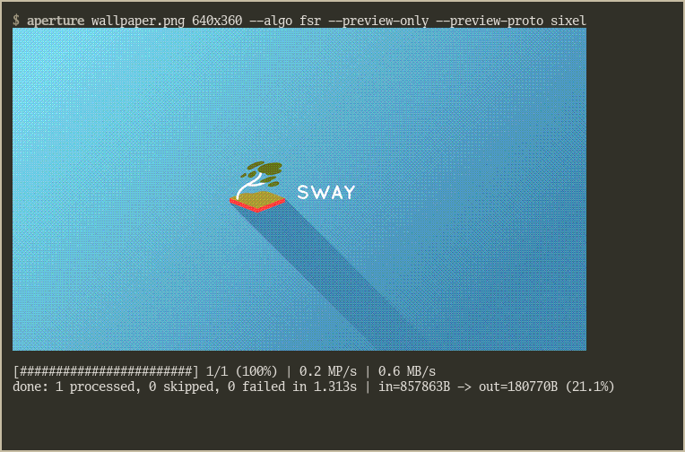
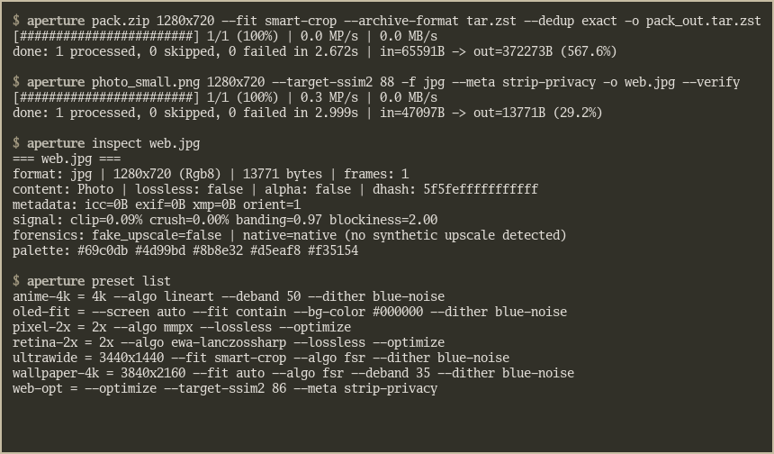
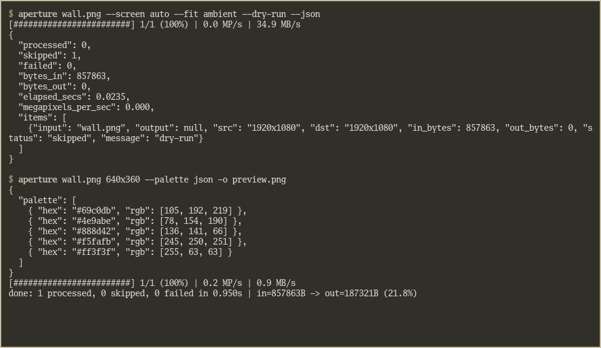

# Aperture

Pure-Rust image scaler, wallpaper fitter, forensic analyzer, and archive batch processor for Linux.

Aperture resizes single images, directory trees, and nested archives without neural networks or external C imaging libraries. Resampling runs in linear RGB, sigmoidal light, or Oklab using cache-blocked separable passes, polar EWA Jinc kernels, FSR 1.0 EASU/RCAS, iterative back-projection, and edge-directed pixel-art scalers, backed by a thread-local arena and deterministic memory budget.



## Features

- Linear-light, sigmoidal, and Oklab resampling across 24 kernel modes: EWA LanczosSharp, FSR 1.0 (EASU + RCAS), iterative back-projection (IBP), SSimDown/SSimSuperRes, KrigBilateral chroma upscaling, ICBI, NEDI, Anime4K-style lineart deblur, MMPX, xBRZ, ScaleFX, Lanczos3/4, Mitchell, Catmull-Rom, Hermite, Box, and Nearest
- Pre-scale restoration and post-scale finishing: `resdet`-style DCT zero-crossing native resolution detection (`--descaled`), JPEG block smoothing (`--dejpeg`), guided denoising (`--denoise`), multi-pass debanding (`--deband`), blue-noise/Floyd/Bayer dithering (`--dither`), and alpha-bleed correction
- Wallpaper and aspect fitting across 11 modes (`auto`, `smart-crop`, `seam-carve`, `ambient`, `extend`, `mirror`, `gradient`, `contain`, `stretch`, `tile`, `split`) with integral-image saliency, `--safe-zone` UI avoidance, border trimming (`--trim-borders`), bezel compensation (`--bezel`), and Oklab palette export (`json` / `css`)
- Linux desktop integration: Wayland (`wl_output` / `xdg_output_manager_v1`), X11 (`RandR`), and `/sys/class/drm` monitor detection (`--screen auto`), wallpaper application via compositor/DE backends (`--set`), `inotify` watch mode (`--watch`), and terminal previews (`kitty`, `sixel`, `sextant`, `half`)
- Output safety and compression control: safe `--alongside` default, atomic `-i` / `--replace` with `fsync` + `rename` and `--backup`, `--keep-dates`, `--verify` decode/CRC check, and closed-loop `--target-ssim2` / `--max-bytes` rate search
- Hardened streaming archive pipeline (`.zip`, `.tar`, `.tar.gz`, `.tar.zst`, `.tar.xz`, `.tar.bz2`, and nested archives) with central/local header consistency verification, Zip-Slip path checks, non-overlapping extent validation, decompression byte/ratio budgets, non-image preservation, and exact or perceptual dHash deduplication

## Supported formats

| Category | Built-in | Optional Cargo feature |
| --- | --- | --- |
| Still images | `png`, `jpg`, `webp`, `tiff`, `qoi`, `bmp`, `tga`, `pnm`, `ico`, `ff`, `hdr`, `exr` | `jxl`, `avif`, `svg` |
| Animations | `gif`, `apng` (`png`), animated `webp` | none |
| Archives | `zip`, `tar`, `tar.gz`, `tar.zst`, `tar.xz`, `tar.bz2` | none |

The optional `avif` feature requires `nasm` on the host to build `rav1d`.

## Requirements

- Linux on x86_64 or aarch64 (AVX2/FMA SIMD vertical kernels activate at runtime on supported CPUs with scalar fallback)
- Rust `1.89+` (Edition 2024) and Cargo to build from source

## Installation

```sh
git clone https://github.com/ignicat/aperture.git
cd aperture
cargo build --release
```

The release binary is placed at `target/release/aperture` and links only against `libc`, `libm`, and `libgcc_s`.

To install into Cargo's binary directory (`~/.cargo/bin`):

```sh
cargo install --path crates/cli
```

To enable optional format decoders at build time (for example JPEG XL and SVG):

```sh
cargo build --release --workspace --features core/jxl,core/svg
```

## Usage

```text
aperture <inputs...> [target] [flags]
aperture process|fit|archive|inspect|compare|bench|watch|preset|completions ...
```

### Target specification DSL

Targets accept ASCII `x`, Cyrillic `х`, `*`, `:`, resolution aliases (`fhd`, `qhd`, `uwqhd`, `4k`, `8k`), single-edge constraints (`1920w`, `1080h`), relative multipliers (`2x`, `150%`), aspect/megapixel rules (`ar:21:9`, `mp:12`), conditional bounds (`>`, `<`, `^`, `!`), comma-separated multi-target lists, or live display queries (`--screen auto`, `--screen DP-1`, `--screen span`).

### Common commands

```sh
# Fit and upscale a wallpaper alongside the source file
aperture wallpaper.png 3840x2160 --fit auto --algo fsr --deband 35 --dither blue-noise --verify

# Match the active Wayland or X11 monitor automatically and apply the wallpaper
aperture wallpaper.png --screen auto --fit auto --algo adaptive --set

# Atomically replace the original file with backup and preserved timestamps
aperture photo.jpg 1920х1080 -i --backup --keep-dates --verify

# Optimize lossy output against a perceptual SSIM2 quality target
aperture photo.png 1280x720 --target-ssim2 88 -f jpg --meta strip-privacy

# Repack a multi-level archive while keeping non-images and deduplicating duplicates
aperture pack.zip 1280x720 --fit smart-crop --archive-format tar.zst --dedup exact --non-images keep -o pack_out.tar.zst

# Inspect headers, signal clipping/banding, palette, and fake-upscale probability
aperture inspect image.png --json

# Compare distortion metrics between a reference and candidate image
aperture compare reference.png candidate.png

# Benchmark kernels on an image and report throughput plus roundtrip SSIM2
aperture bench sample.png 1280x960 --iters 5
```

### Presets

Built-in presets can be invoked with `-p` / `--preset`:

| Preset | Expansion |
| --- | --- |
| `wallpaper-4k` | `3840x2160 --fit auto --algo fsr --deband 35 --dither blue-noise` |
| `ultrawide` | `3440x1440 --fit smart-crop --algo fsr --dither blue-noise` |
| `retina-2x` | `2x --algo ewa-lanczossharp --lossless --optimize` |
| `pixel-2x` | `2x --algo mmpx --lossless --optimize` |
| `anime-4k` | `4k --algo lineart --deband 50 --dither blue-noise` |
| `web-opt` | `--optimize --target-ssim2 86 --meta strip-privacy` |
| `oled-fit` | `--screen auto --fit contain --bg-color #000000 --dither blue-noise` |

Manage custom presets or generate shell completions (`bash`, `zsh`, `fish`, `nushell`):

```sh
aperture preset list
aperture preset save desktop "--screen auto --fit auto --algo fsr --verify"
aperture completions fish > ~/.config/fish/completions/aperture.fish
```

## Visual examples

Untouched PNG outputs generated directly by `aperture` from system raster assets.

### Raster upscaling (64x64 to 256x256)

| Nearest | Lanczos3 (linear) | EWA LanczosSharp | FSR 1.0 (EASU + RCAS) |
| --- | --- | --- | --- |
|  |  |  |  |

### Pixel-art scaling (36x26 to 216x156)

| Nearest | MMPX | xBRZ | ScaleFX |
| --- | --- | --- | --- |
|  |  |  |  |

### Ultrawide aspect fitting (16:9 to 21:9)

| Contain (`#0d1117` matte) | Smart crop | Ambient matte | Seam carving |
| --- | --- | --- | --- |
|  |  |  |  |

## Screenshots

Terminal sessions captured in `foot` on Wayland (`halley`).

| Inline Sixel preview | Archive repack and target SSIM2 | Display auto-detect and palette JSON |
| --- | --- | --- |
|  |  |  |

## Configuration

Custom presets are stored at `$XDG_CONFIG_HOME/aperture/presets.conf` (fallback `$HOME/.config/aperture/presets.conf`) as `name = flags` lines. Resume journals default to `.resume.journal` unless an explicit path is passed to `--resume`.

## Exit codes

| Code | Meaning |
| --- | --- |
| `0` | Success |
| `1` | Fatal I/O, decode, encode, or system backend failure |
| `2` | Invalid CLI arguments or target specification |
| `3` | Partial batch failure (one or more items skipped or failed under batch mode) |
| `4` | Security budget violation, malformed archive header, or `--verify` failure |

## Limitations

- Targets Linux only (`rustix`, Wayland `xdg_output_manager_v1`, X11 `RandR`, `inotify`).
- Scaling and restoration are deterministic signal-processing algorithms. Heavily destroyed low-resolution textures are reconstructed mathematically rather than hallucinated with diffusion or neural networks.
- The `--set` wallpaper flag invokes compositor or desktop-specific utilities (`awww`, `swww`, `hyprctl`, `swaymsg`, `plasma-apply-wallpaperimage`, `gsettings`, `xfconf-query`) when running under Wayland/DEs, or updates the X11 root pixmap directly under bare X11.

## License

Dual-licensed under [MIT](LICENSE-MIT) or [Apache-2.0](LICENSE-APACHE).
